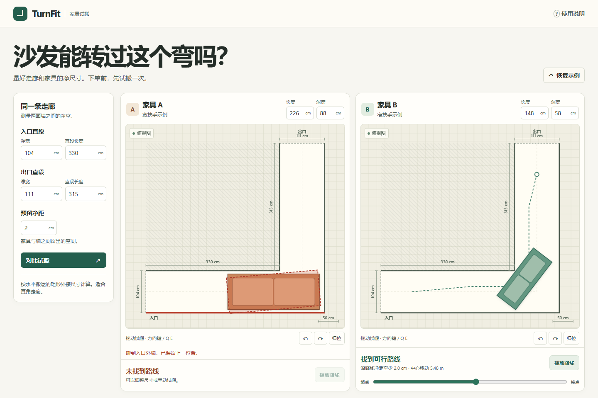

# TurnFit · 家具试搬

在同一个直角走廊里比较两件家具。用真实尺寸试搬，查看墙面碰撞，并回放求解器找到的搬运路线。

[在线试玩](https://quocdatn547-web.github.io/turnfit/)

## 直接使用

用 Chrome 或 Edge 打开 `dist/index.html`。这是单个文件，无需安装或联网。打开后会自动计算内置示例。

- 用 104 cm 和 111 cm 的走廊，比较 226 × 88 cm 和 148 × 58 cm 的两款沙发。
- 在任一俯视图上拖动家具。聚焦画布后也可以用方向键移动、Q / E 旋转。
- 播放 B 的路线，再把 A 改为 142 × 55 cm 重试。
- 实际使用时，从内拐角起量两段的净宽和可用直段长度。家具用水平外接长方形表示。

找到的路线通过模型内的连续碰撞验证。未找到路线表示本次有限搜索没有找到解。高度、倾斜、局部凸起和搬运人员的空间需要另行处理。

## 开发

需要 Node.js。运行 `node build.mjs` 生成离线单文件，运行 `node --test tests/geometry.test.cjs` 检查连续路线和典型反例。

- `src/geometry.js` 计算墙面净距，验证两姿态间的连续移动。
- `src/planner.js` 搜索位置和角度，并再次校验用于回放的路径。
- `src/page.html`、`src/style.css`、`src/drawing.js`、`src/app.js` 提供桌面与手机交互。
- `docs/PRD.md` 和 `docs/preflight.md` 保存需求、现有参照与验证门槛。

## English summary

TurnFit is a browser-based furniture moving simulator. It compares two measured rectangular footprints in the same right-angle hallway. Drag and rotate a piece to see what it hits, or play the collision-checked route computed by the app. The standalone HTML runs offline.

Open the [live demo](https://quocdatn547-web.github.io/turnfit/). In the built-in example, the planner finds no route for the 226 × 88 cm sofa and finds a validated route for the 148 × 58 cm sofa. Click the green playback button on furniture B, or drag a piece and rotate it with Q and E. Replace the dimensions with your own measurements and run the comparison again.

The model covers horizontal movement through a right-angle corridor. Search failure means no path was found within the search, and a successful path is valid for the dimensions entered.
